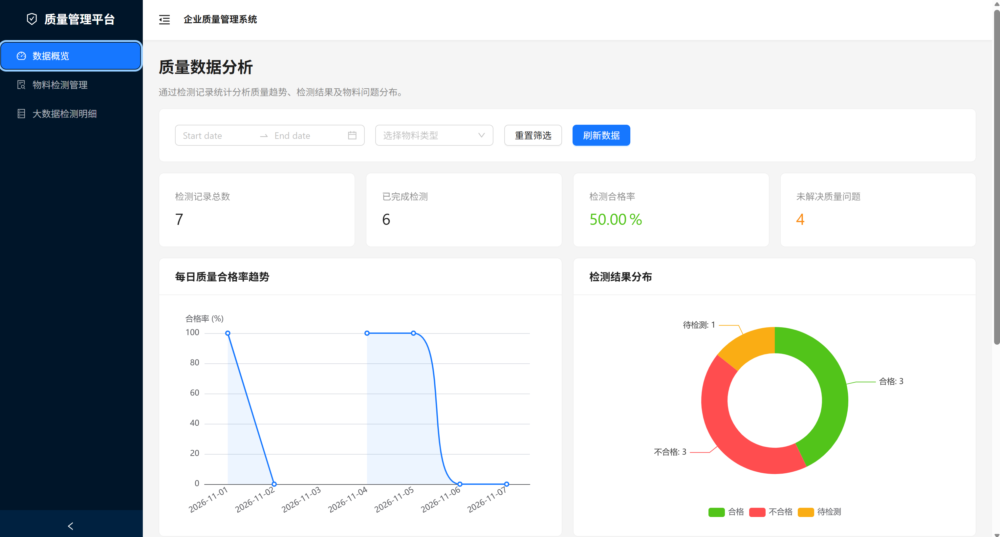
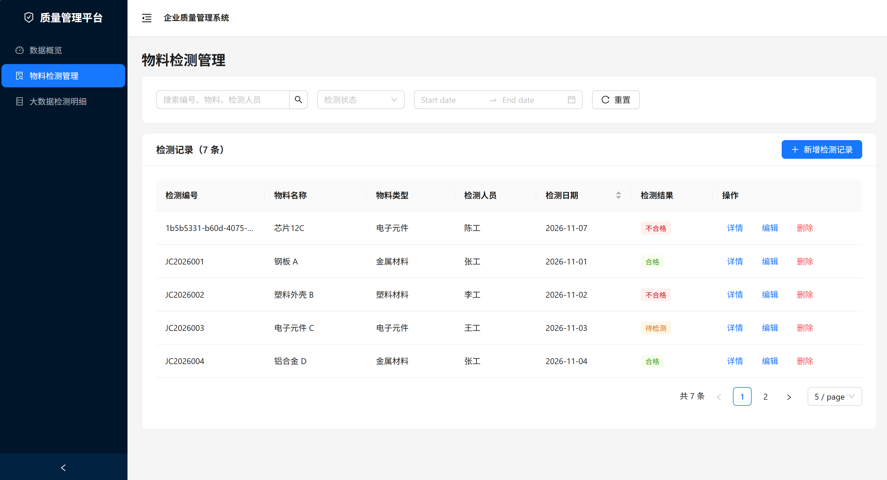
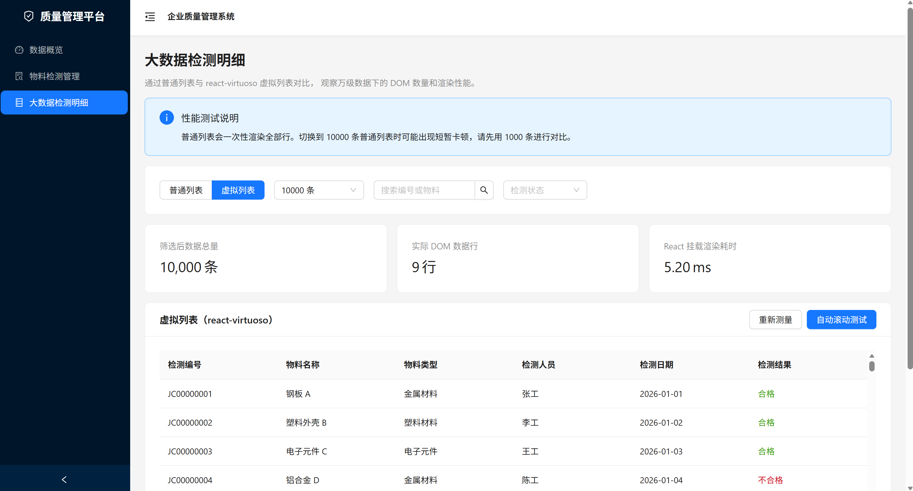

# Quality Management Dashboard

基于 React + TypeScript 开发的企业质量管理平台 Demo，模拟物料检测管理、质量数据分析及大数据列表优化等业务场景。

项目主要用于前端技术学习与面试展示，所有业务数据均为模拟数据。

## 一、技术栈

- **前端框架：** React + TypeScript + Vite
- **UI 组件库：** Ant Design
- **路由管理：** React Router
- **网络请求：** Axios
- **数据可视化：** ECharts
- **虚拟列表：** react-virtuoso
- **后端服务：** Node.js + Express
- **代码规范：** ESLint + Prettier
- **工程化：** Husky + lint-staged + GitHub Actions

## 二、核心功能

### 1. 物料检测管理

- 实现检测记录的新增、编辑、删除与查询。
- 支持关键词搜索、状态筛选、日期筛选及分页。
- 基于 Ant Design Form 实现表单校验。
- 基于 Axios 封装统一请求实例，对接 Express REST API。
- 支持检测详情查看、操作反馈与异常提示。

### 2. 万级检测明细虚拟列表

- 使用 react-virtuoso 实现万级数据按可视区域渲染。
- 支持 1,000 / 10,000 条模拟数据切换。
- 提供普通列表与虚拟列表两种渲染模式。
- 支持 DOM 数据行统计、React Profiler 渲染耗时测量与自动滚动测试。

### 3. 质量数据可视化

- 使用 ECharts 展示每日质量合格率趋势。
- 统计合格、不合格和待检测记录分布。
- 统计不同物料类型的不合格数量。
- 展示客户投诉分类演示图表。
- 支持日期范围、物料类型筛选及指标动态更新。

### 4. 工程化与性能优化

- 基于 React.lazy + Suspense 实现路由懒加载。
- 通过 Vite 动态导入实现代码分割。
- 使用 ECharts Core 按需注册图表组件。
- 配置静态资源缓存策略。
- 使用 ESLint、Prettier 和 Git Hooks 规范代码质量。
- 通过 GitHub Actions 自动检查代码与生产构建。

## 三、性能优化结果

以下数据来自个人 Demo 的本地测试环境。

| 性能指标                   |    优化前 |   优化后 |     改善幅度 |
| -------------------------- | --------: | -------: | -----------: |
| 万级列表 DOM 数据行数      | 10,000 行 |  约 9 行 | 减少约 99.9% |
| 物料检测页初始 JS 传输量   |    804 KB | 416.3 KB | 减少约 48.2% |
| 大数据明细页初始 JS 传输量 |    804 KB | 286.7 KB | 减少约 64.3% |

**优化说明：**

1. 使用 react-virtuoso 减少实际创建的数据行 DOM 数量。
2. 使用 React.lazy + Suspense 减少非当前页面代码的初始加载。
3. 通过 ECharts 按需引入减少不必要的图表模块依赖。
4. 使用 Chrome DevTools Network 和 React Profiler 辅助测量性能。

**测试声明：** 以上为本地 Demo 的阶段性测试结果，不代表企业生产系统性能指标。DOM 行数减少率和 JS 传输体积减少率不等同于整体页面性能提升比例。

## 四、项目结构

```text
quality-management-dashboard/
├── src/
│   ├── api/               # Axios 业务接口
│   ├── components/        # 公共组件与图表组件
│   ├── data/              # 演示数据
│   ├── pages/             # 业务页面
│   ├── types/             # TypeScript 类型
│   ├── utils/             # 请求封装、模拟数据工具
│   ├── App.tsx            # 路由配置
│   └── main.tsx           # 应用入口
├── server/
│   ├── data/              # JSON 模拟数据库
│   └── index.cjs          # Express 服务
├── docs/
│   └── images/            # 项目截图
├── .github/
│   └── workflows/         # CI 配置
├── package.json
└── vite.config.ts
```

## 五、本地运行

### 1. 安装依赖

```bash
npm install
```

### 2. 启动 Express 后端

```bash
npm run server
```

默认地址：`http://localhost:3001`

### 3. 启动 React 前端

另开一个终端：

```bash
npm run dev
```

默认地址：`http://localhost:5173`

### 4. 生产构建与启动

```bash
npm run build
npm start
```

生产模式由 Express 同时提供前端页面和 API，默认访问 `http://localhost:3001`。

## 六、代码质量检查

运行 ESLint：

```bash
npm run lint
```

运行 Prettier 格式检查：

```bash
npm run format:check
```

自动格式化：

```bash
npm run format
```

检查 TypeScript 并构建：

```bash
npm run build
```

项目通过 Husky + lint-staged 在 Git 提交前检查暂存文件，通过 GitHub Actions 在推送后执行自动化检查。

## 七、项目截图

### 数据概览



### 物料检测管理



### 虚拟列表



## 八、在线演示

**在线体验：** https://quality-management-dashboard.onrender.com/

**GitHub 仓库：** https://github.com/1013638073cjy-ai/quality-management-dashboard

## 九、项目说明

- 本项目为个人学习与技术展示 Demo，并非实际企业生产系统。
- 业务数据使用 JSON 文件与本地模拟数据。
- 客户投诉分类目前使用演示数据。
- 公开部署环境中的 JSON 数据不保证长期持久化。
- 本项目使用 Vite 构建。
